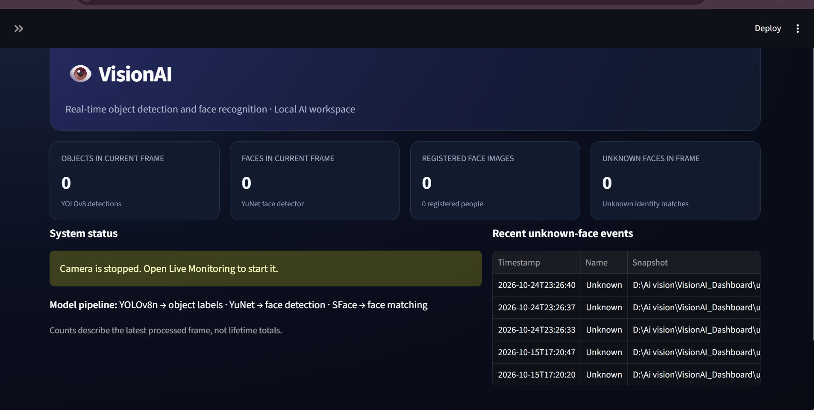

# Real-Time Object and Face Recognition using YOLOv8 🎯🧠

A Python-based real-time object and face recognition system using the **YOLOv8** deep learning model and `face_recognition`, integrated with **OpenCV** for webcam-based live detection. The project runs on GPU (CUDA) for faster performance and supports logging of unknown faces along with periodic snapshots.

---
## Object Detection and Face Recognition through real time footage with yolo and pytorch
## 🔍 Features

- ✅ Real-time object detection using YOLOv8 (pre-trained on COCO dataset)
- ✅ Real-time face recognition with custom known faces
- ✅ Logs unknown faces every 2 seconds with snapshot storage
- ✅ Supports GPU acceleration (CUDA)
- ✅ CSV logging of unknown detections with timestamps
- ✅ Clean bounding box overlays with labels and confidence scores

---

## 🚀 Technologies Used

- [Ultralytics YOLOv8](https://github.com/ultralytics/ultralytics)
- [OpenCV](https://opencv.org/)
- [face_recognition](https://github.com/ageitgey/face_recognition)
- [NumPy](https://numpy.org/)
- Python 3.10+

---

## 📂 Folder Structure

- project_root/
- │
- ├── detect.py # Main script
- ├── known_faces/ # Folder with subfolders for each known person
- │ └── Alice/
- │ ├── alice1.jpg
- │ └── alice2.jpg
- ├── snapshots/ # Automatically stores unknown face images
- ├── unknown_log.csv # CSV log of unknown detections
- ├── yolo-Weights/
- │ └── yolov8n.pt # YOLOv8 model file
- └── README.md
## 💾 Installation

### 1. Clone the repository

```bash
git clone https://github.com/Durgpratap07/AIVision.git
cd AIVision
```

### 2. Create a virtual environment

**Windows (PowerShell):**

```powershell
python -m venv venv
.\venv\Scripts\Activate.ps1
```

If PowerShell blocks activation, use the environment's Python executable directly in the next steps.

### 3. Install dependencies

```powershell
python -m pip install --upgrade pip
python -m pip install -r VisionAI_Dashboard/requirements-dashboard.txt
```

### 4. Verify the model files

Ensure the following files are present in `VisionAI_Dashboard/`:

- `yolov8n.pt` — YOLOv8 object detection model
- `models/face_detection_yunet_2023mar.onnx` — YuNet face detection model
- `models/face_recognition_sface_2021dec.onnx` — SFace face recognition model

These model files are included in the repository, so you should not need to download them separately.

### 5. Launch the VisionAI dashboard

```powershell
cd VisionAI_Dashboard
python -m streamlit run app.py
```

Streamlit will provide a local URL, usually `http://localhost:8501`. Open it in your browser to use the dashboard.

### ⚠️ Notes

- Run the commands from the repository's root directory unless the instructions specify otherwise.
- Keep personal face images, generated logs, and secret configuration files out of Git.
- If a dependency installation fails, check the error message and your Python version before changing package versions.
 ## 📸 Dashboard Preview


🛠️ Future Improvements

 Sound alert on unknown detection (optional)

 Option to trigger snapshot for known users too

 Dashboard UI for visual logs

 Optimize for edge devices or Raspberry Pi

 Integrate TrOCR or handwriting recognition for diary/logs

👤 Author

DURG PRATAP SINGH
durgpratap07

- Feel free to connect or reach out on GitHub for collaborations or questions!
